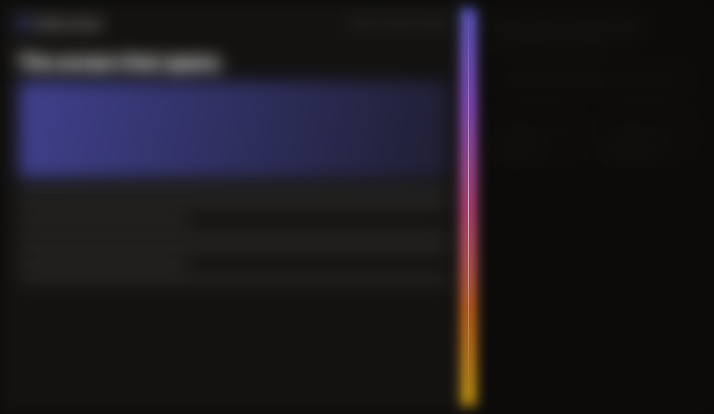
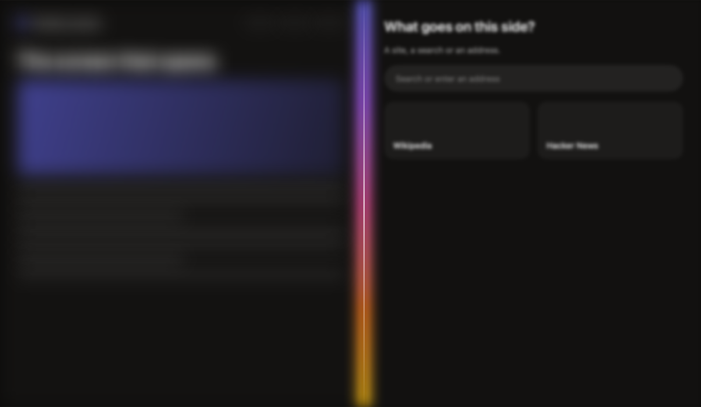
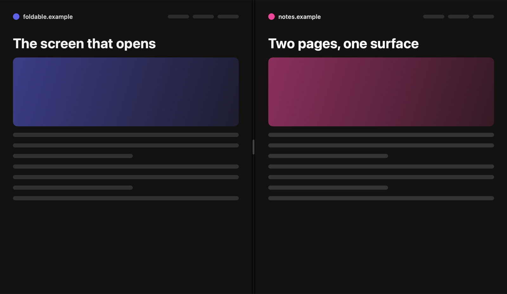

# Browser Split Pages

Two pages on the same surface, with a hinge between them, opened and folded back the way a foldable phone's screen does. A SwiftUI component for macOS browsers (or anything with two views to show side by side), with a small demo browser to try it.

<p align="center">
  
  
  
</p>

## What it does

- **Split mode.** ⌘\ opens a second page beside the one on screen: a seam of light grows down the middle, the page goes out of focus as it makes room, and the new side comes into focus.
- **One surface.** Both pages sit on the same card, with a narrow band and a hairline between them.
- **The hinge.** Drag it to share the room. It settles on thirds and halves with a tap of the trackpad, shows how the room is shared ("60 · 40") while it's held, and goes back to the middle on a double-click.
- **Fold a page away.** Drag the hinge nearly to an edge: the page about to go blurs and dims as it gets closer, and letting go folds it away.
- **Back to one page.** ⌘\ again folds the other page away, in the same movement reversed. The page with the keyboard stays.
- **Live blur.** The real pages go out of focus, web views included, while they lay themselves out again behind the blur. That's why a foldable blurs its screen while it opens.
- Under Reduce Motion, the surface changes at once.

## Use it

Add the package (Swift Package Manager), then:

```swift
import SplitPages
import SwiftUI

struct BrowserView: View {
    @State private var split = SplitPagesState()

    var body: some View {
        SplitPagesView(state: split) {
            PageView(page: leadingPage)    // any view: a web view, a document, a list
        } trailing: {
            PageView(page: trailingPage)
        }
    }
}
```

And a key for it, in your app's commands:

```swift
Button(split.isSplit ? "Back to One Page" : "Split Pages") { split.toggle() }
    .keyboardShortcut("\\")
```

`SplitPagesState` has what your app needs:

| | |
|---|---|
| `unfold()` | Opens the other side beside the page on screen. |
| `fold(keeping:)` | Folds back to one page, `.leading` or `.trailing`. |
| `toggle()` | Opens, or folds back to the page with the keyboard. |
| `center()` | Shares the room evenly. |
| `ratio` | The leading page's share of the width. |
| `focused` | The page with the keyboard (the other rests a touch dimmer). A click on a page gives it the keyboard. |
| `onFold` | Called after a page folds away, with its side (to load something new there next time, say). |
| `animates` | Off to change the surface at once. |

`FoldTimeline` (each moment of an opening or a fold, as numbers), `SplitHingeMath` (where the hinge settles) and `SeamLight` are public too, for drawing your own.

## Try the demo

```sh
swift run SplitPagesDemo
```

Or build an app you can double-click, in `build/`:

```sh
scripts/make-demo-app.sh
```

The demo is a small browser: one page, ⌘\ for a second one (it asks what goes there), the hinge to share the room, ⌘\ again to fold back.

## How it works

- **A timeline, not springs.** `FoldTimeline` gives every moment of an opening (0.82 s) or a fold (0.7 s): where the hinge is, how out of focus each page is, and how bright the seam is, on curves solved the way browsers solve CSS's. The view redraws on every display refresh while one runs, and stays still otherwise.
- **Pages stay put.** Both pages are always in the view (a hidden one is zero wide), so a web view keeps its page, history and scroll through openings and folds.
- **The band.** Web views take every click over themselves, so the hinge lives in the band between the pages, a few points wide.
- **Drags in window coordinates.** The hinge moves under the pointer, so its own coordinates would drift.

## Requirements

macOS 14 or later, Swift 6.

```sh
swift test
```

## License

Apache License 2.0. See [LICENSE](LICENSE).
